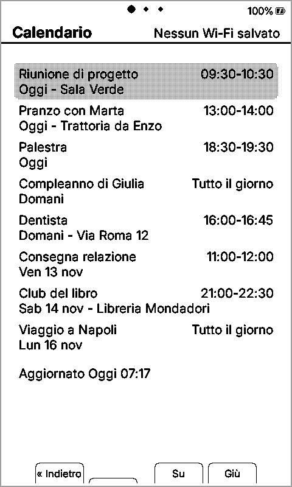
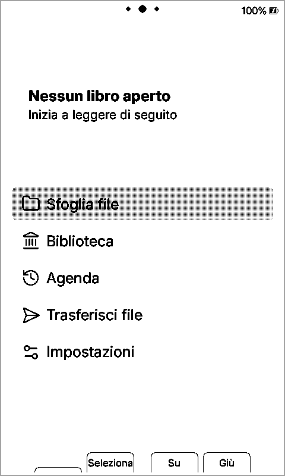
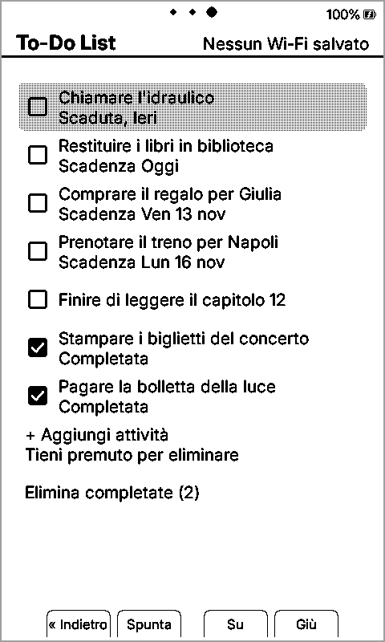
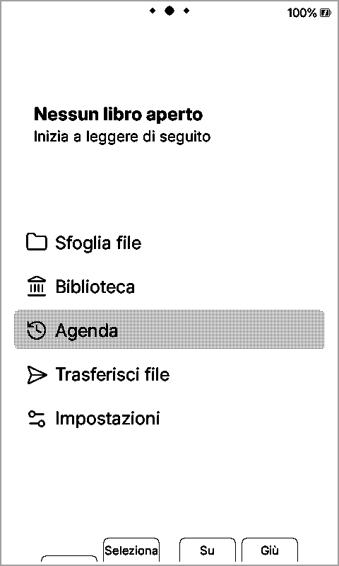
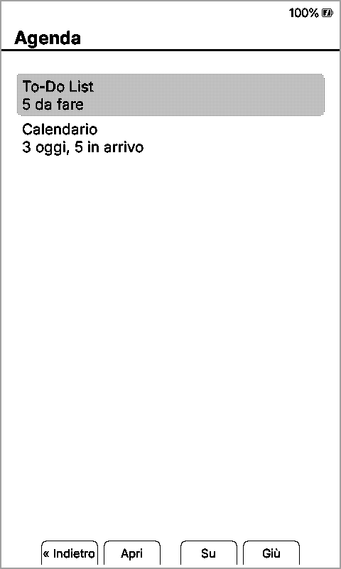
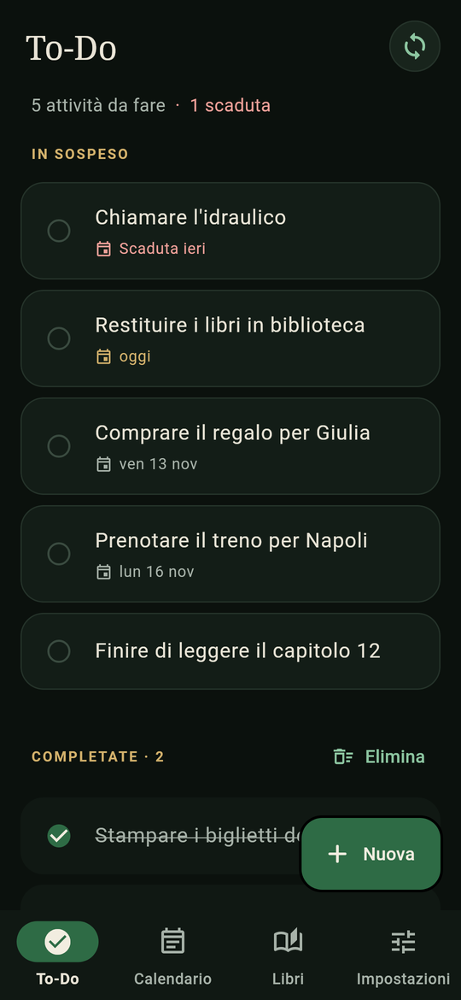
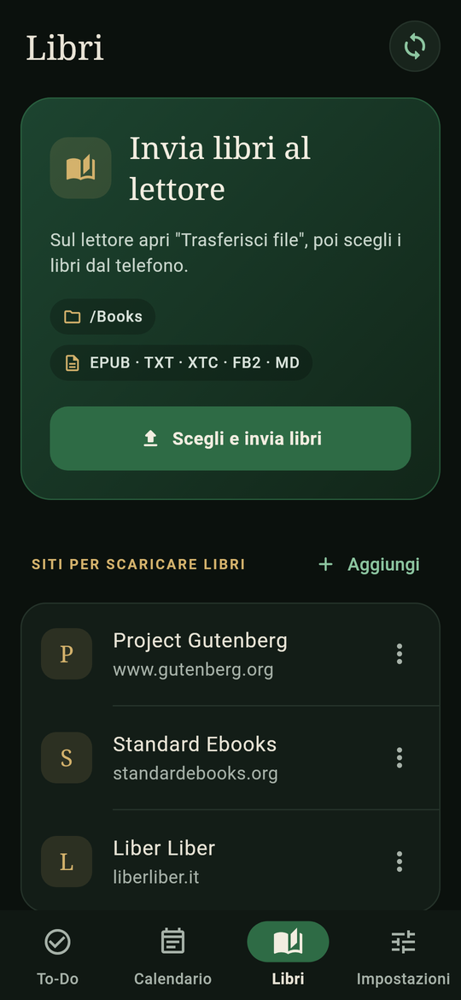
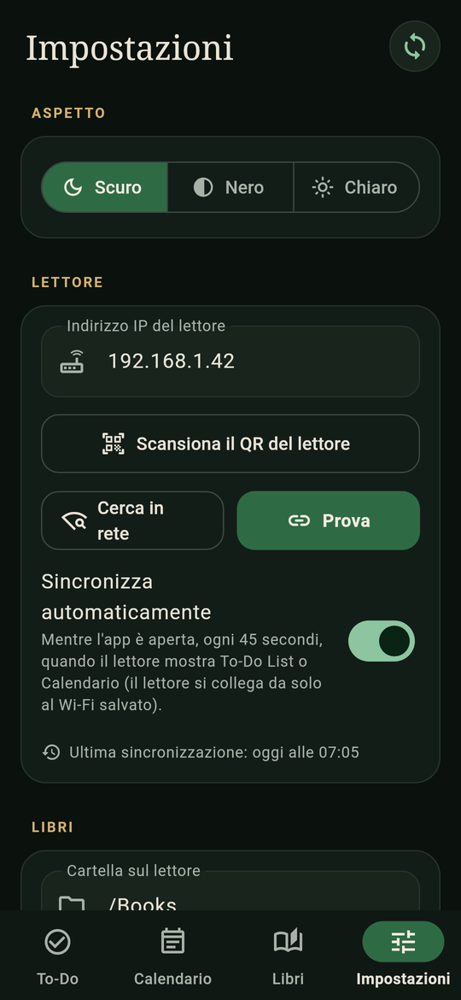

<h1 align="center">CrossInk-Planner</h1>

<p align="center">
  Firmware per i lettori e-ink <b>Xteink X3 e X4</b> che aggiunge a
  <a href="https://github.com/uxjulia/CrossInk">CrossInk</a> una <b>To-Do List</b>, un <b>Calendario</b>
  e una <b>app companion per Android</b> che li sincronizza.
</p>

<p align="center">
  <a href="../../releases/latest"><b>⬇ Scarica firmware e app (Release)</b></a> ·
  <a href="#installazione">Installazione</a> ·
  <a href="#come-si-usa">Come si usa</a> ·
  <a href="#app-companion">App companion</a> ·
  <a href="docs/planner-sync.md">Protocollo</a>
</p>

<table>
  <tr>
    <td align="center"><br/><em>Calendario</em></td>
    <td align="center"><br/><em>Home</em></td>
    <td align="center"><br/><em>To-Do List</em></td>
  </tr>
  <tr>
    <td colspan="3" align="center"><em>I tasti laterali passano tra tre pagine: Calendario ← Home → To-Do List</em></td>
  </tr>
</table>

## Novità rispetto a CrossInk

- **To-Do List sul lettore**: spunti le attività, ne aggiungi di nuove con la tastiera a schermo, tieni premuto
  Conferma per eliminarne una, e con un comando elimini tutte quelle completate. Ogni attività ha una casella
  quadrata e può avere una scadenza ("Scadenza Ven 13 nov", "Scaduta, Ieri"). Le attività restano salvate sulla
  scheda SD finché non le elimini.
- **Calendario**: l'agenda da oggi in avanti, con orario, luogo ed eventi di più giorni ripetuti su ogni giorno.
  È in sola lettura: gli eventi li copia l'app companion dagli indirizzi iCal privati dei tuoi calendari (Google
  Calendar, Outlook, iCloud). Il lettore non accede mai al tuo account.
- **Tre pagine con i tasti laterali**: dalla Home il tasto laterale destro (Pagina successiva) apre la To-Do List e
  il sinistro il Calendario; il tasto opposto riporta alla Home. Tre puntini in alto indicano la pagina.
- **Voce "Agenda" nella Home**, con il riepilogo: attività da fare ed eventi di oggi e in arrivo.
- **Schermata di sospensione "Agenda"**: data di oggi, eventi del giorno e attività aperte, visibili anche a lettore
  spento.
- **Sincronizzazione in background**: mentre è aperta la To-Do List o il Calendario il lettore si collega da solo
  all'ultima rete Wi-Fi salvata, così l'app può sincronizzare senza passare da "Trasferisci file". In alto a destra
  vedi lo stato ("Sync 192.168.1.42", "Nessun Wi-Fi salvato"…) e la pagina si aggiorna dopo ogni sincronizzazione.
- **Ripresa della pagina**: se il lettore va in sospensione sulla To-Do List o sul Calendario, al risveglio riapre
  quella pagina.
- **Ora sempre giusta**: a ogni sincronizzazione l'app imposta data, ora e fuso orario (con l'ora legale). Utile
  sull'X4, che non ha un orologio a batteria.
- **API per la companion** nel server di "Trasferisci file" (`/api/planner/*`), descritte in
  [docs/planner-sync.md](docs/planner-sync.md).

Tutto il resto di CrossInk v1.6.1 (font, statistiche di lettura, temi, sincronizzazioni…) è invariato: vedi il
[README originale di CrossInk](docs/CrossInk-README.md) e la [guida utente](docs/user-guide.md).

<table>
  <tr>
    <td align="center"><br/><em>Voce Agenda nella Home</em></td>
    <td align="center"><br/><em>Riepilogo dell'Agenda</em></td>
    <td align="center"><br/><em>Sospensione "Agenda"</em></td>
  </tr>
</table>

## Installazione

Dispositivi: **Xteink X3** e **Xteink X4** (file `firmware-x3-x4.bin`, lo stesso per entrambi).

1. Scarica `firmware-x3-x4.bin` dall'ultima [Release](../../releases/latest).

**Dalla scheda SD** (il modo più semplice, funziona anche sui lettori con l'USB bloccato):

2. Copia il file `.bin` in una cartella qualsiasi della scheda SD (via cavo, con "Trasferisci file" o con un lettore
   di schede).
3. Sul lettore: **Impostazioni → Sistema → Aggiornamento firmware da SD**, scegli il file e conferma. Non spegnere il
   lettore finché non si riavvia.

**Via USB con esptool** (macOS e Linux):

```sh
pip3 install esptool
# Linux: porta /dev/ttyACM0 (controlla con: dmesg | grep tty) — macOS: /dev/cu.usbmodem… (ls /dev/cu.*)
esptool.py --chip esp32c3 --port /dev/ttyACM0 --baud 921600 write_flash 0x10000 firmware-x3-x4.bin
```

Le impostazioni, i libri e le statistiche di CrossInk restano dove sono. Per tornare a CrossInk originale basta
installare il suo firmware da [inky.crossink.dev](https://inky.crossink.dev/#flash-tools) o dalla SD.

## Come si usa

| Dove | Tasto | Cosa fa |
| --- | --- | --- |
| Home | Laterale destro (Pagina successiva) | Apre la **To-Do List** |
| Home | Laterale sinistro (Pagina precedente) | Apre il **Calendario** |
| To-Do List / Calendario | Laterale opposto | Torna alla **Home** |
| Liste | Su / Giù | Sposta la selezione |
| To-Do List | Conferma (Spunta) | Spunta o toglie la spunta all'attività |
| To-Do List | Conferma tenuto premuto | Elimina l'attività (chiede conferma) |
| To-Do List | Conferma su "+ Aggiungi attività" | Nuova attività con la tastiera a schermo |
| To-Do List | Conferma su "Elimina completate" | Elimina tutte le attività spuntate |

Per la schermata di sospensione: **Impostazioni → Schermo → Schermata sospensione → Agenda**.

Le attività create sul lettore non hanno scadenza; le date le aggiungi dall'app. I dati stanno in
`/.crosspoint/planner/` sulla SD (`todos.json` e `calendar.json`).

## App companion

**CrossInk Companion** è l'app Android che gestisce attività, calendari e libri e li sincronizza con il lettore in
rete locale. L'APK è allegato a ogni [Release](../../releases/latest) di questo repository.

<table>
  <tr>
    <td align="center"><br/><em>To-Do</em></td>
    <td align="center"><br/><em>Calendario</em></td>
    <td align="center"><br/><em>Libri</em></td>
    <td align="center"><br/><em>Impostazioni</em></td>
  </tr>
</table>

- **To-Do**: attività con scadenza, unite a quelle del lettore (per ogni attività vince la modifica più recente).
- **Calendario**: legge i calendari dagli indirizzi iCal privati, ricorrenze e fusi orari compresi, e invia al
  lettore i prossimi giorni.
- **Libri**: invia EPUB, TXT, XTC, FB2 e MD al lettore e apre siti di e-book (Project Gutenberg, Standard Ebooks,
  Liber Liber…) da cui scaricarli e inviarli con un tocco.
- **Impostazioni**: temi Scuro, Nero e Chiaro, scanner del QR code del lettore e degli indirizzi iCal,
  sincronizzazione automatica.

Primo collegamento: sul lettore apri **Home → Trasferisci file** e collegati al Wi-Fi di casa (così il lettore salva
la rete); nell'app tocca **Impostazioni → Scansiona il QR del lettore**, aggiungi i calendari e premi
**Sincronizza**. Da quel momento basta aprire la To-Do List o il Calendario sul lettore.

## Per sviluppatori

- Branch: `main` contiene il fork pubblicato; lo sviluppo avviene su `feat/planner`. I branch `ci-results/*`
  contengono solo log e file generati da GitHub Actions.
- Codice del Planner: `src/activities/planner/` (schermate), `src/PlannerStore.*` (salvataggio su SD),
  `src/network/PlannerApi.*` (API per la companion), `lib/Planner/` (logica pura: date, JSON, unione delle
  attività), `src/platform/PlannerPlatform.h` (orologio e numeri casuali, anche nel simulatore).
- Test nativi: `test/planner/`. Workflow: `.github/workflows/planner-ci.yml` (test, formattazione, build per X3/X4 e
  X4 Pro, analisi statica, `firmware.bin` nel branch `ci-results/<branch>`).
- Immagini di questo README: `scripts/planner_screenshots.py` fa girare il firmware nel
  [simulatore](docs/simulator.md) con dati di esempio; il workflow `planner-screenshots.yml` pubblica le PNG nel
  branch `ci-results/screenshots`.
- Per compilare valgono le istruzioni di CrossInk in [docs/development](docs/development).

## Crediti

Basato su [CrossInk](https://github.com/uxjulia/CrossInk) di uxjulia, a sua volta fork di
[CrossPoint Reader](https://github.com/crosspoint-reader/crosspoint-reader). Stessa licenza del progetto originale
(vedi [LICENSE](LICENSE)). Non è un progetto ufficiale Xteink né CrossInk.
